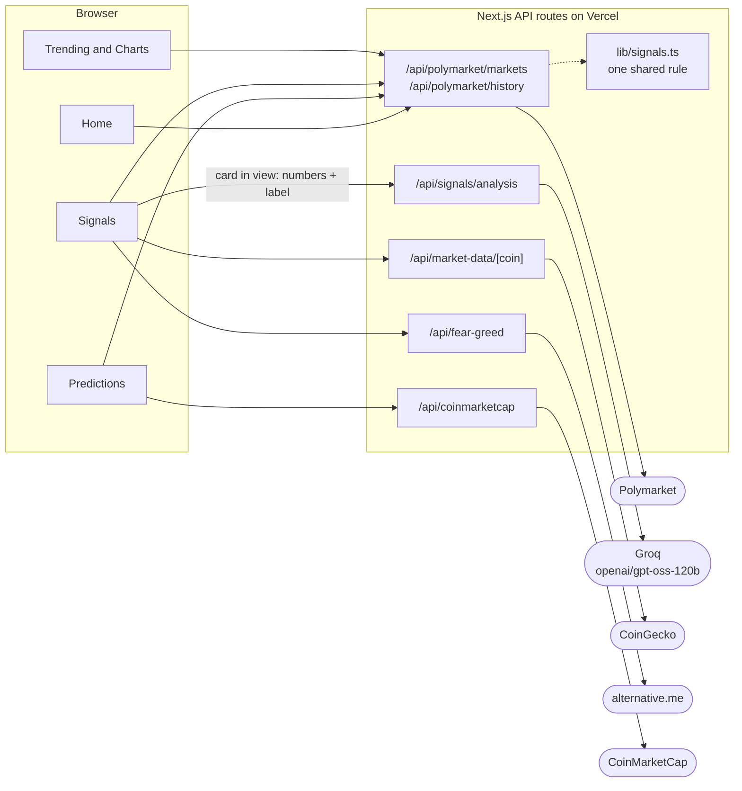
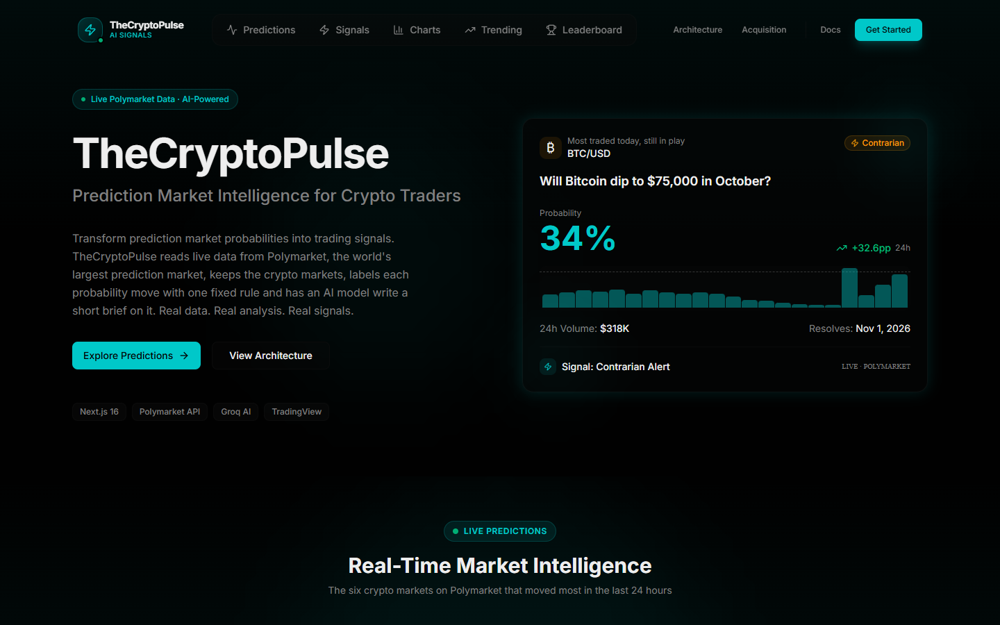
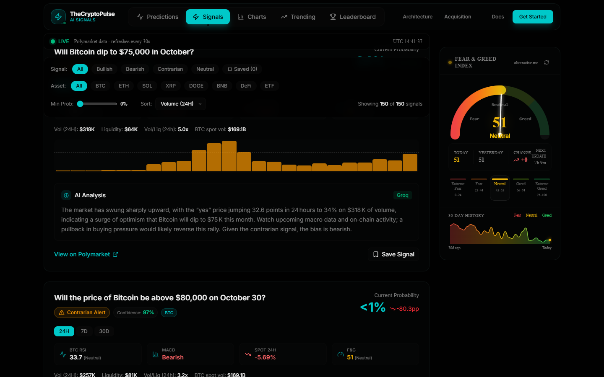
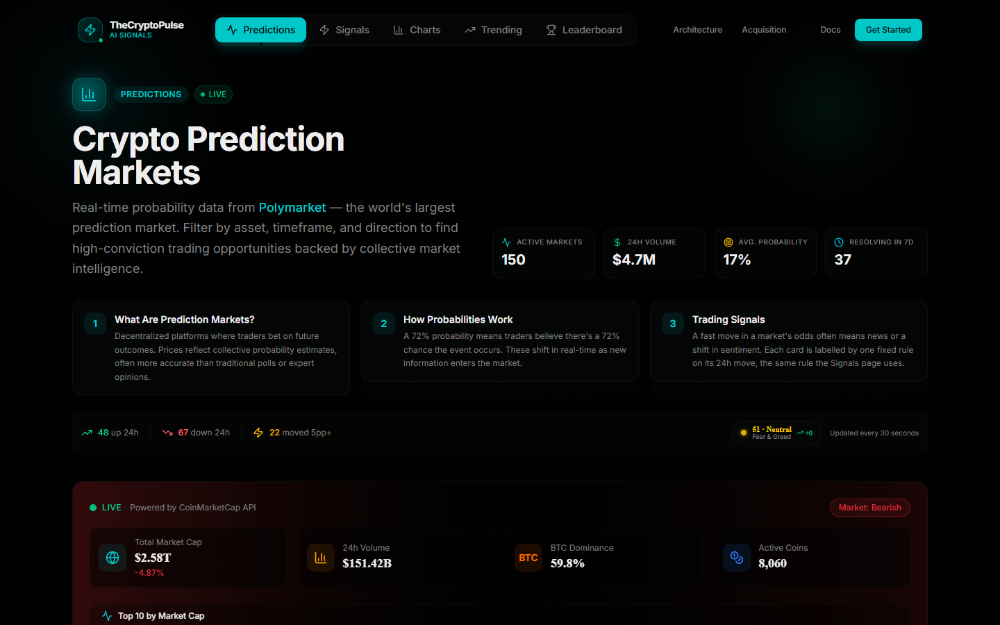

# CryptoPulse

Live Polymarket prediction-market odds turned into crypto trading signals. One plain rule labels every market, and an AI model writes a short brief on each one.

**Live:** [thecryptopulse.xyz](https://thecryptopulse.xyz) | **Built:** March 2026, reworked October 2026

## The idea

When the odds on "Will Bitcoin dip to $75,000 in October?" jump 30 points in a day, the crowd is changing its mind with money behind it. I wanted to read those moves as trading signals, next to the spot price and the usual indicators.

CryptoPulse is one of a few conceptual attempts at an architecture I wanted out of my head and running. This one is a small pipeline with the AI last. Server routes pull and trim public data, one shared rule in `lib/signals.ts` labels each market, and the model only explains a label it was given. It never sets one. If the model call fails, the card still has its label and its numbers.

## How it works

Next.js 16, React 19, Tailwind and shadcn/ui on Vercel. There is no database, cron job or sign-in. Pages poll the API routes, and each route caches its upstream calls so many visitors share one request.

- `/api/polymarket/markets` flattens Polymarket's highest-volume crypto events into up to 150 trimmed markets, and `/api/polymarket/history` gives each market's Yes-price history.
- `lib/signals.ts` is the one rule every page uses. Over 24 hours, a long shot (35% or less) jumping 5 points or more, or a favourite (65% or more) dropping 5 points or more, is contrarian. Any other move of 2 points or more is bullish or bearish. The rest is neutral.
- `/api/signals/analysis` sends one market's numbers and label to `openai/gpt-oss-120b` on Groq for a two or three sentence brief, cached for 30 minutes. Each browser asks for at most two briefs at a time, and a brief still queued when its card leaves the screen is dropped, so a fast scroll doesn't burn the free tier's rate limit.
- `/api/market-data/[coin]` computes RSI (14, Wilder) and MACD (12/26/9) from 30 days of CoinGecko candles.
- `/api/fear-greed` reads alternative.me's index, and three `/api/coinmarketcap` routes serve the market overview.



## Status

Live and working as of 30 October 2026: 150 live markets, the signal rule on every page, AI briefs, RSI and MACD, the Fear & Greed gauge, Trending and Charts on live data, and saved signals kept in the browser. Accounts aren't built, and the sign-in page says so. The Leaderboard is labelled as simulated, and the Architecture and Acquisition pages pitch the project itself.

## How I built it

I wrote the concept and spec and built the first version by directing v0, Vercel's AI app builder, over March 2026. In October 2026 I reworked it with Claude Code: a working AI model in place of a retired one, one signal rule in place of several that disagreed, live data and real price history where pages had sample numbers, a request loop fixed, briefs paced to fit the free rate limit, site copy that matches the code, and type errors no longer ignored at build time. I don't hand-write the code.

## Screenshots







## Run it locally

You need Node.js 20.9 or newer and pnpm.

```bash
pnpm install
pnpm dev
```

Copy `.env.example` to `.env.local`. `GROQ_API_KEY` turns on the AI briefs, and without it each card shows a short template instead. `CMC_API_KEY` is for the CoinMarketCap overview. The code's fallback key is masked in this copy. Polymarket, CoinGecko and alternative.me need no keys.

This repository is a snapshot of the code as of 2026-10-30. The working repository is private.
